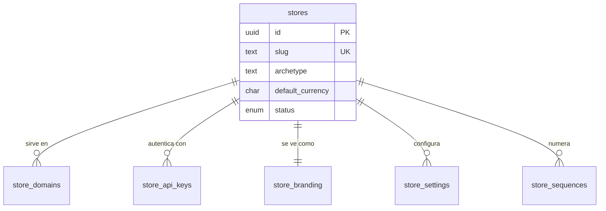
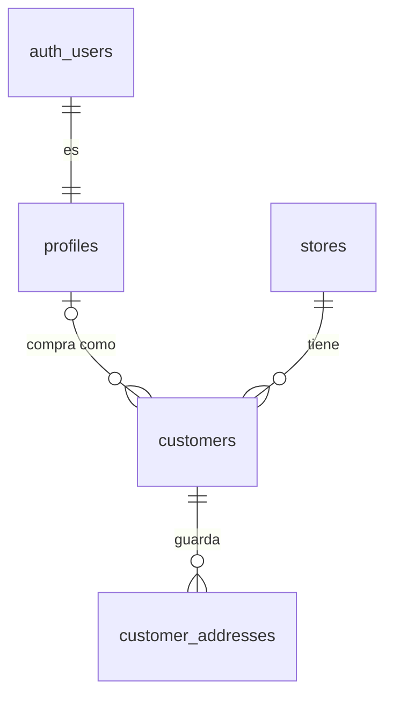
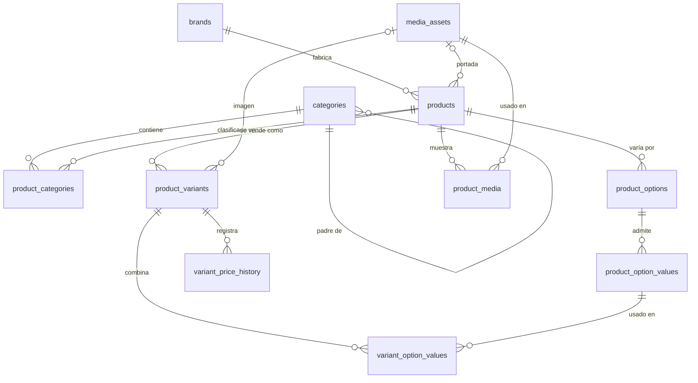
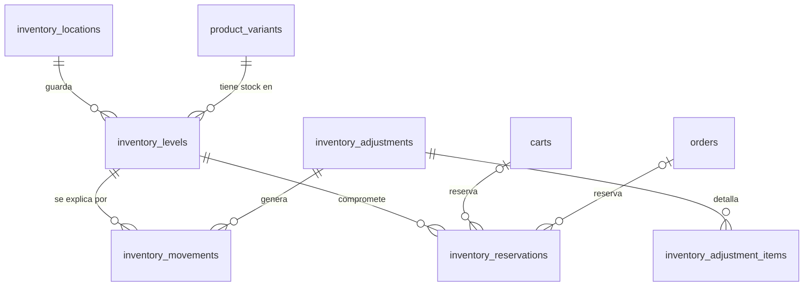
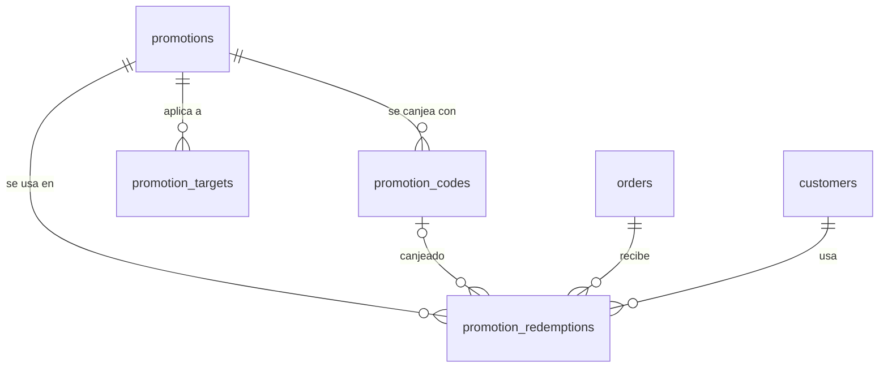
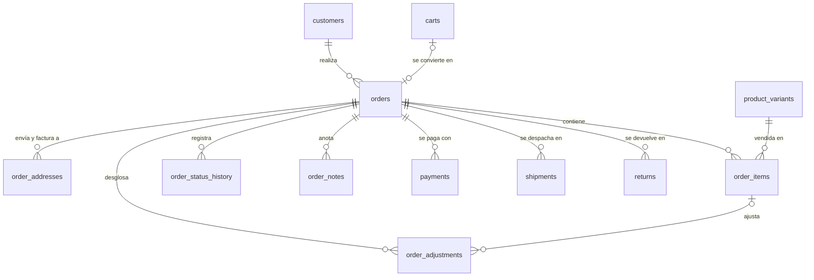
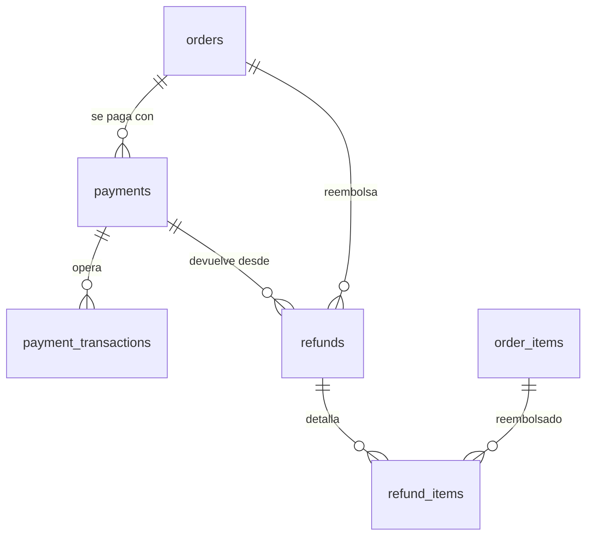

# Modelo de la tienda (schema commerce)

Este es el modelo de negocio compartido por el storefront y el panel, ya integrado con el lado administrativo: el personal de la tienda vive en el schema admin y aquí solo quedan los clientes.

## 1. Convenciones globales

Toda tabla de negocio comparte las mismas columnas base y reglas de integridad; no se repiten en cada tabla.

| Campo | Tipo | Descripción |
| --- | --- | --- |
| id | uuid | PK. Evita IDs predecibles. |
| store\_id | uuid | FK a stores. Es el tenant. |
| created\_at, updated\_at | timestamptz | Fechas en UTC. |
| created\_by, updated\_by | uuid (nullable) | Actor del cambio; nulo si fue el sistema. |
| deleted\_at | timestamptz (nullable) | Borrado lógico; nada con valor histórico se borra físicamente. |
| version | int | Bloqueo optimista para detectar ediciones concurrentes. |

- **Integridad multi-tienda.** Cada tabla padre tiene único(store\_id, id) y las hijas referencian el par (store\_id, parent\_id). La base impide mezclar datos de tiendas distintas; RLS de Supabase filtra por store\_id como segunda defensa.
- **Dinero.** numeric(12,2) (o enteros en centavos, pero consistente), siempre con currency\_code ISO 4217 en stores, carts, orders y payments. Nunca float.
- **Estados.** Enums o tablas catálogo; todo estado con relevancia de negocio tiene su tabla de historial.
- **Unicidad con borrado lógico.** Índices únicos parciales (slug, sku, código) solo sobre filas con deleted\_at nulo.
- **Índice base.** Toda tabla indexa store\_id, normalmente como primera columna de índices compuestos.

## 2. Tenancy y configuración

stores es la raíz de todo; dominios, claves, branding y parámetros van en tablas propias para poder rotarlos y auditarlos por separado.

### stores

Tenant raíz; no lleva store\_id.

| Campo | Tipo | Descripción |
| --- | --- | --- |
| name | text | Nombre comercial. |
| slug | text | Identificador URL, único global. |
| archetype | text / enum | Plantilla visual base (por ejemplo "Pro"). |
| default\_currency | char(3) | Moneda de la tienda. |
| default\_locale, timezone | text | Formato y zona horaria (define el "día" en reportes). |
| status | enum | active / suspended / archived. |

**Índices:** único(slug).

### store\_domains

Reemplaza allowed\_origin; una tienda puede tener varios dominios. Campos: domain, is\_primary, verified\_at. **Índices:** único(domain); único parcial(store\_id) donde is\_primary.

### store\_api\_keys

Claves rotables y revocables.

| Campo | Tipo | Descripción |
| --- | --- | --- |
| key\_prefix | text | Primeros caracteres visibles para identificarla. |
| key\_hash | text | Hash; nunca texto plano. |
| scopes | text\[\] | Lectura de catálogo, checkout, etc. |
| last\_used\_at | timestamptz | Monitoreo. |
| expires\_at, revoked\_at | timestamptz | Ciclo de vida. |

**Índices:** único(key\_hash); (store\_id, revoked\_at).

### store\_branding

1:1 con stores. Campos: logo\_asset\_id, favicon\_asset\_id (FK a media\_assets), color\_overrides (jsonb; válido porque no se consulta ni relaciona). **Índices:** único(store\_id).

### store\_settings

Parámetros clave-valor sin tocar el esquema (impuestos incluidos, stock negativo, minutos de reserva de carrito). Campos: key, value (jsonb). **Índices:** único(store\_id, key).

### store\_sequences

Numeración correlativa sin huecos, con bloqueo de fila. Campos: sequence\_name (order / invoice / return / import / export / adjustment), prefix, last\_value. **Índices:** único(store\_id, sequence\_name).

## 3. Clientes

Una persona tiene un solo profile global y un customer por cada tienda donde compra; los invitados son customers sin profile.

### profiles

Datos personales globales, 1:1 con auth.users; sin store\_id. Campos: id (= auth.users.id), full\_name, phone, avatar\_url.

### customers

| Campo | Tipo | Descripción |
| --- | --- | --- |
| profile\_id | uuid (nullable) | Nulo si compró como invitado. |
| email | citext | Case-insensitive. |
| first\_name, last\_name, phone | text | Contacto. |
| accepts\_marketing, marketing\_consent\_at | bool, timestamptz | Consentimiento con fecha. |
| total\_orders, total\_spent | int, numeric | Métricas cacheadas y recalculables. |
| tags | text\[\] | Segmentación. |

**Índices:** único parcial(store\_id, email); único parcial(store\_id, profile\_id).

### customer\_addresses

Libreta de direcciones; los pedidos copian un snapshot y no apuntan aquí.

| Campo | Tipo | Descripción |
| --- | --- | --- |
| customer\_id | uuid | FK a customers. |
| alias | text | "Casa", "Oficina". |
| recipient\_name, phone | text | Quién recibe. |
| line1, line2, city, province, postal\_code | text | Dirección. |
| country\_code | char(2) | ISO. |
| is\_default\_shipping, is\_default\_billing | bool | Predeterminadas por separado. |

**Índices:** (store\_id, customer\_id); único parcial(customer\_id) donde is\_default\_shipping.

## 4. Catálogo

El producto es la ficha comercial; la variante (SKU) es lo que se vende, tiene precio y stock, y es a lo que apuntan carrito, pedido e inventario.

La galería completa vive en product\_media; la portada se cachea en products para listados sin joins.

### brands

Campos: name, slug, logo\_asset\_id. **Índices:** único parcial(store\_id, slug).

### categories

| Campo | Tipo | Descripción |
| --- | --- | --- |
| parent\_id | uuid (nullable) | Auto-referencia. |
| name, slug | text | Nombre e identificador URL. |
| path | ltree / text | Ruta materializada (ropa.hombre.remeras) para traer subárboles sin recursión. |
| depth | int | Nivel. |
| sort\_order | int | Orden entre hermanos. |
| icon, image\_asset\_id | text, uuid | Presentación. |
| is\_active | bool | Visibilidad. |

**Índices:** único parcial(store\_id, slug); (store\_id, parent\_id, sort\_order); GiST sobre path.

### product\_categories

N:M. Campos: product\_id, category\_id, is\_primary, sort\_order. **Índices:** PK(product\_id, category\_id); (category\_id, sort\_order); único parcial(product\_id) donde is\_primary.

### products

| Campo | Tipo | Descripción |
| --- | --- | --- |
| brand\_id | uuid | FK a brands. |
| name | text | Nombre. |
| handle | text | Identificador estable para importaciones. |
| slug | text | URL de SEO, cambiable sin romper importaciones. |
| description, short\_description | text | Descripción larga y para listados. |
| status | enum | draft / active / archived. "Agotado" se deriva del inventario. |
| product\_type | text | Físico / digital / servicio. |
| seo\_title, seo\_description | text | SEO. |
| attributes | jsonb | Especificaciones no filtrables (material, garantía). |
| featured\_asset\_id, featured\_image\_url | uuid, text | Portada y su URL cacheada. |
| rating\_avg, rating\_count | numeric, int | Cacheados desde reviews. |
| published\_at | timestamptz | Publicación programada. |
| created\_via, source\_import\_job\_id | enum, uuid | Origen: manual / import / api. |

**Índices:** único parcial(store\_id, handle); único parcial(store\_id, slug); (store\_id, status); índice de texto (trigram o full-text) sobre name.

### product\_options y product\_option\_values

Ejes de variación en lugar de JSON.

| Tabla | Campos | Ejemplo |
| --- | --- | --- |
| product\_options | product\_id, name, sort\_order | Talle, Color |
| product\_option\_values | option\_id, value, sort\_order, swatch\_hex | M, Rojo / #FF0000 |

**Índices:** único(product\_id, name); único(option\_id, value).

### product\_variants

| Campo | Tipo | Descripción |
| --- | --- | --- |
| product\_id | uuid | FK a products. |
| sku, barcode | text | SKU único por tienda; EAN/UPC opcional. |
| price, compare\_at\_price | numeric | Precio vigente y tachado. |
| cost | numeric | Solo visible en el panel. |
| weight\_grams, dimensions | int, jsonb | Para envío. |
| track\_inventory, allow\_backorder | bool | Control de stock. |
| image\_asset\_id, image\_url | uuid, text | Imagen propia de la variante. |
| is\_default, position | bool, int | Variante única y orden. |

**Índices:** único parcial(store\_id, sku); (product\_id, position).

### variant\_option\_values

Combina variante y valores (Talle M + Color Rojo). **Índices:** PK(variant\_id, option\_value\_id); (option\_value\_id).

### variant\_price\_history

Cada cambio de precio inserta una fila. Campos: variant\_id, price, compare\_at\_price, cost, valid\_from, valid\_to (nulo = vigente), changed\_by, reason ("Campaña VER27", "Importación IMP-000123"). **Índices:** (variant\_id, valid\_from desc).

### media\_assets

| Campo | Tipo | Descripción |
| --- | --- | --- |
| kind | enum | image / video / document. |
| storage\_provider | enum | local / ftp / s3 / supabase. |
| storage\_path, public\_url | text | Ruta interna y URL servida. |
| mime\_type, size\_bytes, width, height | varios | Metadatos. |
| alt\_text | text | Accesibilidad y SEO. |
| checksum | text | Detecta duplicados. |

**Índices:** (store\_id, created\_at); (store\_id, checksum).

### product\_media, variant\_media, category\_media

Tablas puente con FK reales en lugar de una relación polimórfica. Campos: entidad\_id, asset\_id, role (cover / gallery / thumbnail / video / size\_guide), sort\_order, is\_featured. **Índices:** PK(entidad\_id, asset\_id); (entidad\_id, sort\_order); único parcial(product\_id) donde is\_featured.

## 5. Inventario

El stock no se edita, se mueve: cada cambio es un movimiento inmutable y inventory\_levels es solo el saldo cacheado de esos movimientos.

### inventory\_locations

Depósitos o sucursales. Campos: name, code, address (jsonb), is\_active, fulfills\_online\_orders. **Índices:** único(store\_id, code).

### inventory\_levels

| Campo | Tipo | Descripción |
| --- | --- | --- |
| variant\_id, location\_id | uuid | Clave de negocio. |
| on\_hand | int | Unidades físicas. |
| reserved | int | Comprometidas en carritos o pedidos. |
| available | int | on\_hand − reserved (columna calculada). |
| bin\_location | text | "Pasillo 4, estante B". |
| reorder\_point | int | Umbral de reposición. |

**Índices:** único(variant\_id, location\_id); (store\_id, location\_id); parcial donde available ≤ reorder\_point.

### inventory\_movements

Libro mayor inmutable (solo inserts); sumándolo se reconstruye cualquier saldo.

| Campo | Tipo | Descripción |
| --- | --- | --- |
| variant\_id, location\_id | uuid | Qué y dónde. |
| quantity\_delta | int | +10, −1, etc. |
| movement\_type | enum | purchase\_receipt / sale / return / adjustment / transfer\_in / transfer\_out / damage / count\_correction / import. |
| reference\_type, reference\_id | text, uuid | Documento origen: pedido, devolución, ajuste, importación. |
| balance\_after | int | Saldo resultante. |
| reason | text | Obligatorio en ajustes manuales. |
| created\_by | uuid | Actor. |

**Índices:** (variant\_id, location\_id, created\_at desc); (reference\_type, reference\_id). Particionado mensual.

### inventory\_reservations

Evita vender dos veces la última unidad mientras alguien paga. Campos: variant\_id, location\_id, quantity, cart\_id, order\_id, status (active / consumed / released / expired), expires\_at. **Índices:** (status, expires\_at); (cart\_id); (order\_id).

### inventory\_adjustments e inventory\_adjustment\_items

Documento de ajuste manual del panel, detallado en la pestaña Panel administrativo (sección 7).

## 6. Carrito

El carrito puede ser anónimo o de un cliente, y guarda su fusión y conversión para no perder la traza al loguearse o pagar.

### carts

| Campo | Tipo | Descripción |
| --- | --- | --- |
| customer\_id | uuid (nullable) | Nulo si es anónimo. |
| session\_token | text | Identifica carritos anónimos. |
| status | enum | active / merged / converted / abandoned / expired. |
| currency\_code | char(3) | Moneda. |
| promotion\_code\_id | uuid | Cupón aplicado. |
| merged\_into\_cart\_id | uuid | Fusión del anónimo con el del cliente. |
| converted\_order\_id | uuid | Pedido generado. |
| last\_activity\_at, expires\_at | timestamptz | Abandono y vencimiento. |

**Índices:** (store\_id, session\_token); único parcial(store\_id, customer\_id) donde status = active; (status, last\_activity\_at).

### cart\_items

Campos: cart\_id, variant\_id, quantity (check > 0), unit\_price\_snapshot (permite avisar "el precio cambió"), added\_at. **Índices:** único(cart\_id, variant\_id).

## 7. Promociones

La regla, sus códigos, sus objetivos y sus usos van en tablas separadas: así hay promociones automáticas, varios códigos por promoción y límites por cliente verificables.

### promotions

| Campo | Tipo | Descripción |
| --- | --- | --- |
| name | text | Nombre interno. |
| type | enum | percentage / fixed\_amount / free\_shipping / buy\_x\_get\_y. |
| value | numeric | Valor del descuento. |
| applies\_to | enum | order / products / categories / shipping. |
| min\_subtotal, min\_quantity | numeric, int | Condiciones mínimas. |
| max\_discount\_amount | numeric | Tope para porcentajes. |
| starts\_at, ends\_at | timestamptz | Vigencia. |
| usage\_limit\_total, usage\_limit\_per\_customer | int | Límites. |
| is\_automatic, is\_combinable | bool | Sin código; combinable con otras. |
| priority | int | Orden de aplicación. |
| status | enum | draft / active / paused / expired. |

**Índices:** (store\_id, status, starts\_at, ends\_at).

### promotion\_codes

Campos: promotion\_id, code (citext), usage\_limit, times\_used (cacheado). **Índices:** único parcial(store\_id, code).

### promotion\_targets

Campos: promotion\_id, target\_type (product / variant / category / brand), target\_id, is\_exclusion ("todo menos X"). **Índices:** (promotion\_id); (target\_type, target\_id).

### promotion\_redemptions

Cada uso registrado; el uso actual es un dato derivado. Campos: promotion\_id, code\_id, order\_id, customer\_id, discount\_amount, redeemed\_at, reversed\_at (si se cancela el pedido). **Índices:** (promotion\_id, customer\_id); único(order\_id, promotion\_id).

## 8. Pedidos

El pedido es un documento inmutable en sus montos una vez confirmado: guarda snapshots de productos y direcciones, y separa tres estados para reflejar pago y despacho a la vez.

### orders

| Campo | Tipo | Descripción |
| --- | --- | --- |
| order\_number | text | Desde store\_sequences. |
| customer\_id, cart\_id | uuid | Cliente y carrito de origen. |
| customer\_email, customer\_name | text | Snapshot del contacto. |
| currency\_code | char(3) | Moneda. |
| status | enum | pending / confirmed / processing / completed / cancelled. |
| payment\_status | enum | unpaid / authorized / paid / partially\_refunded / refunded. |
| fulfillment\_status | enum | unfulfilled / partial / fulfilled / returned. |
| subtotal, discount\_total, shipping\_total, tax\_total, grand\_total | numeric | Montos. |
| refunded\_total | numeric | Cacheado desde refunds. |
| channel | enum | web / admin / api. |
| customer\_note | text | Nota del cliente (las internas van en order\_notes). |
| ip\_address, user\_agent | text | Antifraude. |
| placed\_at, paid\_at, fulfilled\_at, cancelled\_at | timestamptz | Hitos. |
| cancel\_reason | text | Motivo. |
| assigned\_to | uuid | Operador del panel (admin\_user\_id). |

**Índices:** único(store\_id, order\_number); (store\_id, customer\_id, placed\_at desc); (store\_id, status, placed\_at desc); (store\_id, payment\_status); (store\_id, paid\_at).

### order\_addresses

Snapshot en columnas reales para reportar por zona. Campos: order\_id, address\_type (shipping / billing), recipient\_name, phone, line1, line2, city, province, postal\_code, country\_code, tax\_id (DNI/RUC). **Índices:** único(order\_id, address\_type); (store\_id, province, city).

### order\_items

| Campo | Tipo | Descripción |
| --- | --- | --- |
| variant\_id | uuid | FK; el snapshot preserva la info aunque se borre. |
| product\_name, variant\_title, sku, image\_url | text | Snapshot. |
| unit\_price, quantity | numeric, int | Precio de lista y cantidad. |
| discount\_amount | numeric | Descuento prorrateado; permite reembolsos parciales exactos. |
| tax\_amount, line\_total | numeric | Impuesto y total. |
| quantity\_fulfilled, quantity\_returned | int | Despacho y devolución. |

**Índices:** (order\_id); (store\_id, variant\_id).

### order\_adjustments

Desglose de cada ajuste. Campos: order\_id, order\_item\_id (nulo si aplica al pedido), type (discount / shipping / tax / fee), source\_type, source\_id, label, amount. **Índices:** (order\_id).

### order\_status\_history

Campos: order\_id, status\_field (status / payment\_status / fulfillment\_status), from\_value, to\_value, changed\_by, change\_source (admin / customer / webhook / system), note, created\_at. **Índices:** (order\_id, created\_at).

### order\_notes

Notas internas del panel, detalladas en la pestaña Panel administrativo (sección 7).

## 9. Pagos y reembolsos

Un pedido puede tener varios pagos y cada pago varias operaciones; todo lo que llega del proveedor se guarda crudo y se procesa una sola vez.

### payments

| Campo | Tipo | Descripción |
| --- | --- | --- |
| order\_id | uuid | FK a orders. |
| provider | enum | mercadopago / stripe / manual / etc. |
| method | text | Tarjeta, transferencia, Yape. |
| amount, currency\_code | numeric, char(3) | Monto. |
| status | enum | pending / authorized / captured / failed / cancelled / refunded. |
| external\_id | text | ID en el proveedor. |
| failure\_code, failure\_message | text | Diagnóstico. |
| metadata | jsonb | Datos no estructurados del proveedor. |

**Índices:** único(provider, external\_id); (order\_id).

### payment\_transactions

Libro inmutable. Campos: payment\_id, type (authorize / capture / refund / void / chargeback), amount, status, external\_id, raw\_response (jsonb), processed\_at. **Índices:** (payment\_id, processed\_at).

### refunds y refund\_items

- **refunds:** order\_id, payment\_id, amount, reason, status, restock (bool), created\_by.
- **refund\_items:** refund\_id, order\_item\_id, quantity, amount.

**Índices:** (order\_id); (refund\_id).

### webhook\_events

Bandeja de entrada de webhooks. Campos: provider, external\_event\_id, event\_type, payload (jsonb), signature\_valid, status (received / processed / failed), attempts, error, processed\_at. **Índices:** único(provider, external\_event\_id); (status, created\_at).

## 10. Envíos y devoluciones

Un pedido puede salir en varios paquetes desde distintas ubicaciones y volver en varias devoluciones, cada una con su propio flujo.

| Tabla | Campos | Índices |
| --- | --- | --- |
| shipping\_zones | name, países / provincias / códigos postales cubiertos | (store\_id) |
| shipping\_rates | zone\_id, name, price, free\_over\_amount, min\_weight, max\_weight, estimated\_days | (store\_id, zone\_id) |
| shipments | order\_id, location\_id, carrier, tracking\_number, tracking\_url, status (pending / shipped / in\_transit / delivered / failed), shipped\_at, delivered\_at | (order\_id); (carrier, tracking\_number) |
| shipment\_items | shipment\_id, order\_item\_id, quantity | (shipment\_id) |
| returns | order\_id, return\_number, status (requested / approved / received / rejected / refunded), reason | (order\_id); único(store\_id, return\_number) |
| return\_items | return\_id, order\_item\_id, quantity, condition (new / damaged), restock | (return\_id) |

Recibir una devolución con restock genera un inventory\_movement de tipo return.

## 11. Reseñas y wishlists

Las reseñas se moderan y pueden vincularse a una compra real; las wishlists guardan el precio al agregar para avisar si baja.

### reviews

| Campo | Tipo | Descripción |
| --- | --- | --- |
| product\_id, customer\_id | uuid | Producto y autor. |
| order\_item\_id | uuid (nullable) | Compra verificada. |
| rating | smallint | Check entre 1 y 5. |
| title, body | text | Contenido. |
| status | enum | pending / approved / rejected / hidden. |
| moderated\_by, moderated\_at, moderation\_note | varios | Trazabilidad (moderated\_by = admin\_user\_id). |
| helpful\_count | int | Votos útiles. |

**Índices:** único parcial(product\_id, customer\_id); (store\_id, product\_id, status, created\_at desc).

### wishlists y wishlist\_items

- **wishlists:** customer\_id, name, is\_default, is\_public, share\_token.
- **wishlist\_items:** wishlist\_id, product\_id, variant\_id (nullable), added\_at, price\_at\_add.

**Índices:** (customer\_id); único(wishlist\_id, product\_id, variant\_id).

## 12. Tablas transversales

Dos tablas sirven a todo el modelo: una publica eventos de negocio de forma confiable y otra evita operaciones duplicadas. La auditoría (audit\_log y security\_events) está en la pestaña Panel administrativo, sección 5.

### domain\_events (outbox)

Eventos como order.paid, stock.low o cart.abandoned, escritos en la misma transacción que el cambio para disparar emails, webhooks e integraciones sin perder ninguno.

Campos: event\_type, aggregate\_type, aggregate\_id, payload (jsonb), status (pending / published / failed), attempts, published\_at. **Índices:** (status, created\_at); (aggregate\_type, aggregate\_id).

### idempotency\_keys

Evita pedidos, cobros o reembolsos duplicados por doble clic o reintentos de red.

Campos: key, endpoint, request\_hash, response\_snapshot (jsonb), status, expires\_at. **Índices:** único(store\_id, key); (expires\_at).
