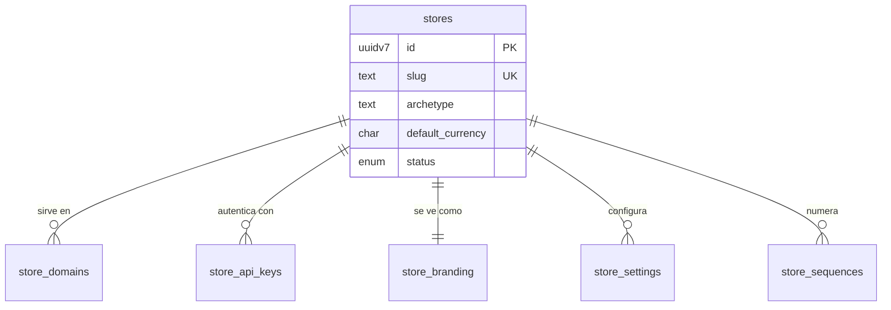
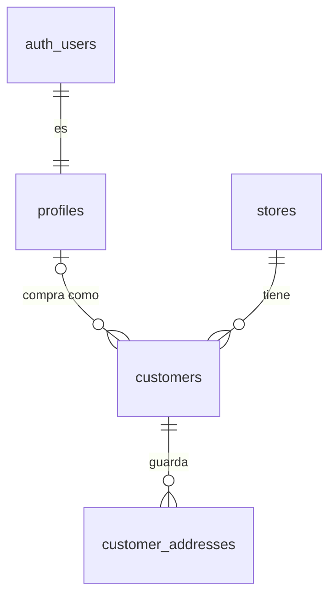
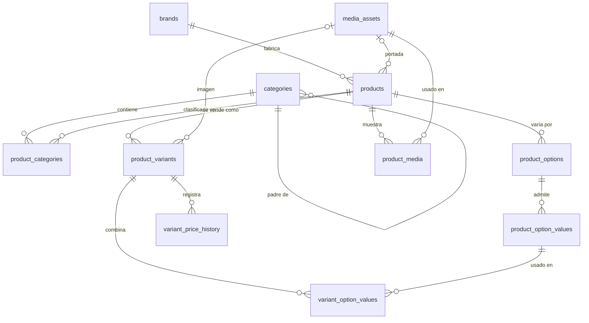
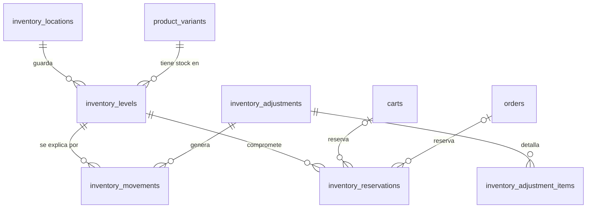
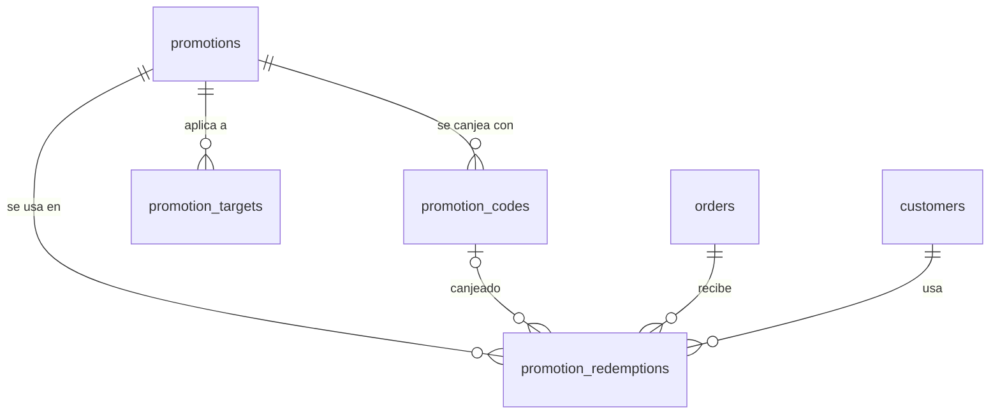
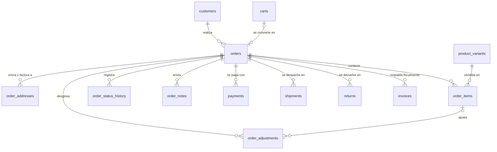
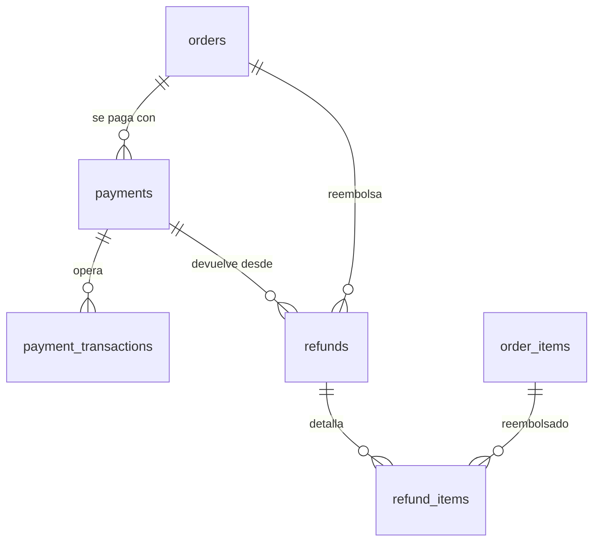
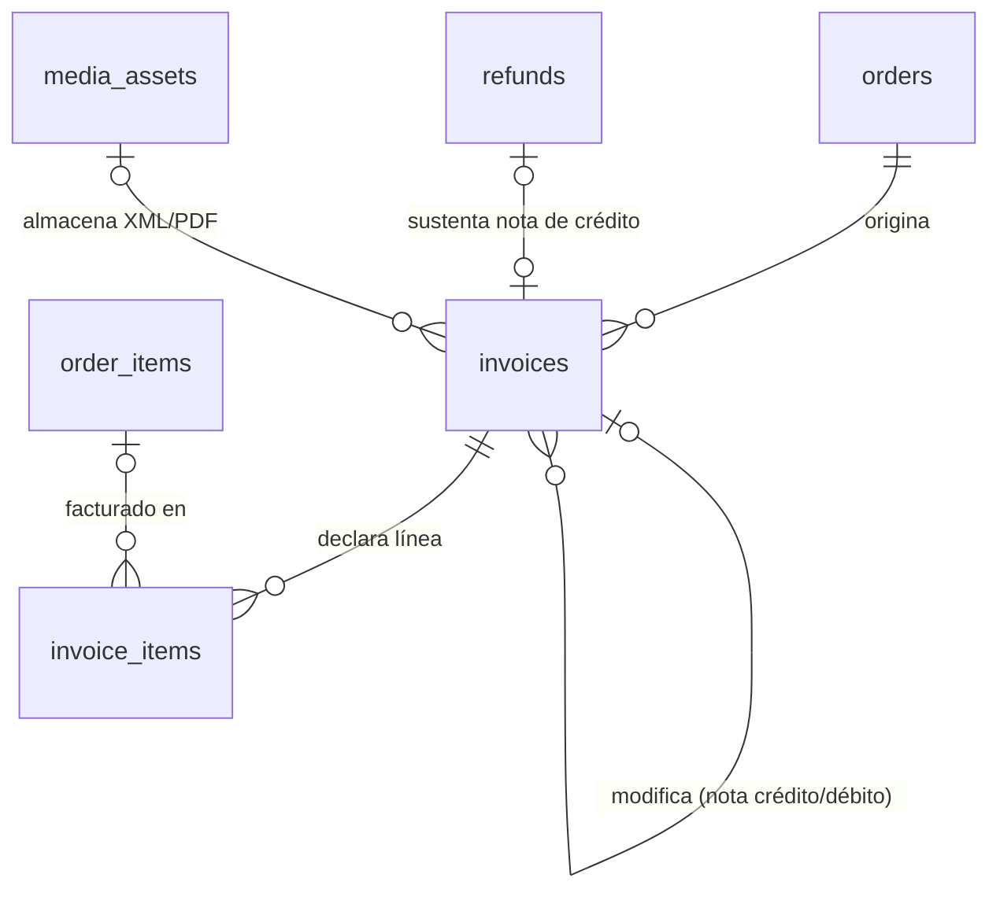

# Modelo Técnico de Base de Datos: Plataforma E-Commerce Multi-Tenant (schema commerce)

Documento de especificación arquitectónica y diseño relacional orientado a PostgreSQL. Este modelo es compartido por el storefront y el panel administrativo (el personal interno opera desde el schema `admin` y aquí residen exclusivamente los clientes y las operaciones comerciales). Está estructurado para soportar alta concurrencia, aislamiento multi-tenant, emisión de comprobantes electrónicos asíncronos y acoplamiento con arquitecturas de microservicios (Java 21, Jakarta EE 10, Quarkus, Spring Boot) mediante CDC (Change Data Capture) y Outbox Pattern.

### Alcance v1

El modelo es genérico (multi-país, multi-moneda, varios proveedores), pero la primera versión opera con estos valores fijos:

| Parámetro | Valor v1 |
| --- | --- |
| País | Perú (`country_code = 'PE'`) |
| Moneda | Sol peruano (`default_currency = 'PEN'`) |
| Locale / zona horaria | `es-PE` / `America/Lima` |
| Impuesto | IGV: `prices_include_tax = true`, `tax_rate = 0.18` |
| Autoridad tributaria | SUNAT (comprobantes: boleta, factura, nota de crédito/débito) |
| Documentos fiscales | DNI, RUC, CE |
| Pasarela de pago | Culqi (`payments.provider = 'culqi'`) |

---

## 1. Convenciones Globales y Reglas de Integridad

Toda tabla de negocio hereda el siguiente bloque estructural base para garantizar consistencia transaccional, trazabilidad y control de concurrencia optimista; no se repiten en la definición individual de cada tabla.

| Campo | Tipo | Descripción y Restricciones |
| --- | --- | --- |
| `id` | `uuidv7` | **PK**. Generado secuencialmente por tiempo (estándar UUIDv7). Evita IDs predecibles y previene la fragmentación severa del índice B-Tree en inserciones masivas. |
| `store_id` | `uuidv7` | **FK** a `stores`. Es el identificador de inquilino (Tenant). |
| `created_at`, `updated_at` | `timestamptz` | Fechas en UTC (`DEFAULT now()`). |
| `created_by`, `updated_by` | `uuidv7` (nullable) | Actor del cambio (admin o cliente); nulo si fue ejecutado por el sistema o proceso batch. |
| `deleted_at` | `timestamptz` (nullable) | Borrado lógico; nada con valor histórico se borra físicamente. |
| `version` | `int` | Bloqueo optimista para detectar ediciones concurrentes. Mapeo directo a `@Version` en Jakarta EE / Hibernate. |

### Directivas de Implementación en Motor y Backend

- **Integridad multi-tienda:** Cada tabla padre define un índice `UNIQUE(store_id, id)` y las tablas hijas referencian el par compuesto `(store_id, parent_id)`. El motor impide mezclar datos de tiendas distintas; las políticas de Row-Level Security (RLS) filtran por `store_id` como segunda línea de defensa.
- **Unicidad y FK con borrado lógico:** Las claves foráneas nativas ignoran el estado de `deleted_at`. La capa ORM en el backend (ej. `@SQLRestriction("deleted_at IS NULL")` en Hibernate) debe gestionar la visibilidad. Todos los índices únicos de negocio (`slug`, `sku`, `code`, `handle`) se implementan como índices únicos parciales condicionados a `WHERE deleted_at IS NULL`.
- **Dinero y Precisión Fiscal:** Uso estricto de `numeric(12,2)` (jamás `float` o `real`), acompañado siempre de `currency_code` (ISO 4217) en `stores`, `carts`, `orders`, `payments` e `invoices`. Para factores de cálculo impositivo se utiliza `numeric(5,4)`.
- **Estados:** Representados mediante tipos `enum` o tablas catálogo; todo estado con relevancia operativa o legal posee su propia tabla de historial inmutable.
- **Índice base:** Toda tabla indexa `store_id` obligatoriamente como primera columna de sus índices compuestos para optimizar los planes de ejecución bajo filtrado RLS.

---

## 2. Tenancy y Configuración

`stores` actúa como la entidad raíz del modelo; dominios, claves de acceso, identidad visual, parámetros y numeradores se segregan en tablas independientes para permitir su rotación, caché y auditoría por separado.

### `stores`
Tenant raíz; única tabla de tienda que no incluye la columna `store_id`.

| Campo | Tipo | Descripción |
| --- | --- | --- |
| `name` | `text` | Nombre comercial de la tienda. |
| `slug` | `text` | Identificador URL, único a nivel global. |
| `archetype` | `text` / `enum` | Plantilla visual base (ej. "Pro"). |
| `default_currency` | `char(3)` | Moneda base contable (ISO 4217). |
| `default_locale`, `timezone` | `text` | Formato regional y zona horaria (define el corte del "día" en reportes financieros). |
| `status` | `enum` | `active` / `suspended` / `archived`. |

**Índices:** `UNIQUE(slug)` parcial (`WHERE deleted_at IS NULL`).

### `store_domains`
Reemplaza configuraciones estáticas de CORS (`allowed_origin`); permite múltiples dominios por tienda.
- **Campos:** `domain` (`text`), `is_primary` (`bool`), `verified_at` (`timestamptz`).
- **Índices:** `UNIQUE(domain)` parcial; `UNIQUE(store_id)` parcial `WHERE is_primary = true AND deleted_at IS NULL`.

### `store_api_keys`
Claves de integración rotables y revocables para consumo del storefront o ERPs externos.

| Campo | Tipo | Descripción |
| --- | --- | --- |
| `key_prefix` | `text` | Primeros caracteres visibles para identificación en interfaz. |
| `key_hash` | `text` | Hash criptográfico de la clave; jamás se almacena en texto plano. |
| `scopes` | `text[]` | Permisos granulares (lectura de catálogo, checkout, etc.). |
| `last_used_at` | `timestamptz` | Monitoreo de actividad. |
| `expires_at`, `revoked_at` | `timestamptz` | Control de ciclo de vida y revocación inmediata. |

**Índices:** `UNIQUE(key_hash)`; `(store_id, revoked_at)`.

### `store_branding`
Relación 1:1 con `stores`.
- **Campos:** `logo_asset_id` (`uuidv7`), `favicon_asset_id` (`uuidv7`, FK a `media_assets`), `color_overrides` (`jsonb`; válido dado que no se filtra ni relaciona).
- **Índices:** `UNIQUE(store_id)`.

### `store_settings`
Parámetros clave-valor dinámicos sin alterar el esquema DDL (control de stock negativo, minutos de expiración de reserva en checkout, reglas impositivas).
- **Campos:** `key` (`text`), `value` (`jsonb`).
- **Claves Fiscales Reservadas Documentadas:**
  - `prices_include_tax` (`boolean`): Define si los precios de catálogo (`product_variants.price`) ya incluyen impuestos o si deben adicionarse en el cálculo del carrito.
  - `tax_rate` (`numeric`): Tasa impositiva vigente por defecto para la tienda (ej. `0.18` para IGV, `0.21` para IVA).
- **Índices:** `UNIQUE(store_id, key)`; **Índice GIN sobre `value`** para consultas de configuración desde el backend.

### `store_sequences`
Numeración correlativa legal y operativa sin saltos (*gapless*), operada mediante bloqueo pesimista de fila (`SELECT ... FOR UPDATE`).
- **Campos:** `sequence_name` (`enum`: `order` / `invoice` / `receipt` / `credit_note` / `debit_note` / `return` / `import` / `export` / `adjustment`), `prefix` (`text`, ej. `F001`, `B001`, `ORD`), `last_value` (`bigint`).
- **Índices:** `UNIQUE(store_id, sequence_name, prefix)`.

---

## 3. Identidad y Clientes

Una persona física posee un único `profile` global en la plataforma y un registro `customer` independiente por cada tienda donde interactúa; los compradores invitados se registran como `customers` con `profile_id` nulo.

### `profiles`
Datos personales globales, relación 1:1 con `auth.users`; no posee `store_id`.
- **Campos:** `id` (`uuidv7`, igual a `auth.users.id`), `full_name` (`text`), `phone` (`text`), `avatar_url` (`text`).

### `customers`

| Campo | Tipo | Descripción |
| --- | --- | --- |
| `profile_id` | `uuidv7` (nullable) | FK a `profiles`. Nulo si operó exclusivamente como invitado. |
| `email` | `citext` | Correo electrónico case-insensitive. |
| `first_name`, `last_name`, `phone` | `text` | Datos de contacto directo. |
| `accepts_marketing`, `marketing_consent_at` | `bool`, `timestamptz` | Estado y marca de tiempo de consentimiento comercial. |
| `total_orders`, `total_spent` | `int`, `numeric(12,2)` | Métricas cacheadas recalculables vía eventos. |
| `tags` | `text[]` | Etiquetas de segmentación comercial. |

**Índices:** `UNIQUE(store_id, email)` parcial (`WHERE deleted_at IS NULL`); `UNIQUE(store_id, profile_id)` parcial (`WHERE profile_id IS NOT NULL AND deleted_at IS NULL`).

### `customer_addresses`
Libreta de direcciones y perfiles fiscales predeterminados del cliente. Los pedidos y facturas copian un *snapshot* inmutable y no mantienen FK activa hacia esta tabla.

| Campo | Tipo | Descripción |
| --- | --- | --- |
| `customer_id` | `uuidv7` | FK a `customers`. |
| `alias` | `text` | Identificador ("Casa", "Oficina"). |
| `recipient_name`, `phone` | `text` | Persona de recepción y teléfono de contacto. |
| `line1`, `line2`, `city`, `province`, `postal_code` | `text` | Desglose geográfico de dirección. |
| `country_code` | `char(2)` | Código de país ISO 3166-1 alpha-2. |
| `tax_document_type` | `text` (nullable) | Tipo de documento fiscal predeterminado (DNI, RUC, RUT, NIT, CE). |
| `tax_document_number` | `text` (nullable) | Número de documento fiscal del receptor. |
| `company_name` | `text` (nullable) | Razón social o nombre legal para facturación. |
| `is_default_shipping`, `is_default_billing` | `bool` | Indicadores de dirección por defecto para envío y facturación. |

**Índices:** `(store_id, customer_id)`; `UNIQUE(customer_id)` parcial `WHERE is_default_shipping = true AND deleted_at IS NULL`; `UNIQUE(customer_id)` parcial `WHERE is_default_billing = true AND deleted_at IS NULL`.

---

## 4. Catálogo y Multimedia

El producto (`products`) representa la ficha comercial; la variante (`product_variants` / SKU) constituye la entidad vendible que posee precio y control de stock, siendo el objetivo de referencia para carritos, pedidos e inventario.

### `brands`
- **Campos:** `name` (`text`), `slug` (`text`), `logo_asset_id` (`uuidv7`, FK a `media_assets`).
- **Índices:** `UNIQUE(store_id, slug)` parcial (`WHERE deleted_at IS NULL`).

### `categories`

| Campo | Tipo | Descripción |
| --- | --- | --- |
| `parent_id` | `uuidv7` (nullable) | Auto-referencia jerárquica a `categories`. |
| `name`, `slug` | `text` | Nombre comercial e identificador URL. |
| `path` | `ltree` | Ruta materializada (ej. `ropa.hombre.remeras`) para consultar subárboles sin CTEs recursivas. |
| `depth` | `int` | Nivel de profundidad en el árbol. |
| `sort_order` | `int` | Orden de visualización entre nodos hermanos. |
| `icon`, `image_asset_id` | `text`, `uuidv7` | Activos de presentación visual. |
| `is_active` | `bool` | Visibilidad en el storefront. |

**Índices:** `UNIQUE(store_id, slug)` parcial; `(store_id, parent_id, sort_order)`; **Índice GiST sobre `path`**.

### `product_categories`
Tabla puente N:M.
- **Campos:** `product_id` (`uuidv7`), `category_id` (`uuidv7`), `is_primary` (`bool`), `sort_order` (`int`).
- **Índices:** `PK(product_id, category_id)`; `(store_id, category_id, sort_order)`; `UNIQUE(product_id)` parcial `WHERE is_primary = true`.

### `products`

| Campo | Tipo | Descripción |
| --- | --- | --- |
| `brand_id` | `uuidv7` (nullable) | FK a `brands`. |
| `name` | `text` | Nombre comercial del producto. |
| `handle` | `text` | Identificador inmutable para procesos de importación/sincronización. |
| `slug` | `text` | URL amigable para SEO, modificable sin romper integraciones de importación. |
| `description`, `short_description` | `text` | Cuerpo descriptivo extendido y resumen para listados. |
| `status` | `enum` | `draft` / `active` / `archived`. El estado "Agotado" se deriva del inventario. |
| `product_type` | `text` | Clasificación operativa: `physical` / `digital` / `service`. |
| `seo_title`, `seo_description` | `text` | Metadatos SEO. |
| `attributes` | `jsonb` | Especificaciones técnicas y atributos dinámicos (material, garantía). |
| `featured_asset_id`, `featured_image_url` | `uuidv7`, `text` | Portada principal y su URL cacheada para listados sin `JOIN`. |
| `rating_avg`, `rating_count` | `numeric(3,2)`, `int` | Promedio y conteo cacheados desde `reviews`. |
| `published_at` | `timestamptz` | Fecha de publicación programada. |
| `created_via`, `source_import_job_id` | `enum`, `uuidv7` | Origen del registro: `manual` / `import` / `api`. |

**Índices:** `UNIQUE(store_id, handle)` parcial; `UNIQUE(store_id, slug)` parcial; `(store_id, status)`; Índice GIN Trigram (`pg_trgm`) o Full-Text sobre `name`; **Índice GIN sobre `attributes`**.

### `product_options` y `product_option_values`
Modelado relacional de ejes de variación en lugar de estructuras JSON acopladas.

| Tabla | Campos | Ejemplo |
| --- | --- | --- |
| `product_options` | `product_id` (`uuidv7`), `name` (`text`), `sort_order` (`int`) | Talle, Color |
| `product_option_values` | `option_id` (`uuidv7`), `value` (`text`), `sort_order` (`int`), `swatch_hex` (`char(7)`) | M, Rojo / `#FF0000` |

**Índices:** `UNIQUE(product_id, name)` en `product_options`; `UNIQUE(option_id, value)` en `product_option_values`.

### `product_variants`

| Campo | Tipo | Descripción |
| --- | --- | --- |
| `product_id` | `uuidv7` | FK a `products`. |
| `sku`, `barcode` | `text` | SKU único por tienda; código EAN/UPC opcional. |
| `price`, `compare_at_price` | `numeric(12,2)` | Precio de venta vigente y precio de lista tachado. |
| `cost` | `numeric(12,2)` | Costo unitario (exclusivo para panel administrativo y márgenes). |
| `weight_grams`, `dimensions` | `int`, `jsonb` | Peso y dimensiones (`{length, width, height}`) para tarificación de envío. |
| `track_inventory`, `allow_backorder` | `bool` | Directivas de control de stock y venta sin disponibilidad. |
| `image_asset_id`, `image_url` | `uuidv7`, `text` | Imagen específica de la variante y URL cacheada. |
| `is_default`, `position` | `bool`, `int` | Indicador de variante por defecto y orden de aparición. |

**Índices:** `UNIQUE(store_id, sku)` parcial (`WHERE deleted_at IS NULL`); `(store_id, product_id, position)`.

### `variant_option_values`
Tabla puente que define la combinación única de cada variante (ej. Variante X = Talle M + Color Rojo).
- **Campos:** `variant_id` (`uuidv7`), `option_value_id` (`uuidv7`).
- **Índices:** `PK(variant_id, option_value_id)`; `(option_value_id)`.

### `variant_price_history`
Registro histórico inmutable; cada modificación de precio inserta una fila.
- **Campos:** `variant_id` (`uuidv7`), `price` (`numeric(12,2)`), `compare_at_price` (`numeric(12,2)`), `cost` (`numeric(12,2)`), `valid_from` (`timestamptz`), `valid_to` (`timestamptz`, nulo = vigente), `changed_by` (`uuidv7`), `reason` (`text`, ej. `"Campaña VER27"`, `"Importación IMP-000123"`).
- **Nota de Integración Reactiva:** Las inserciones en esta tabla se capturan vía CDC para invalidar o notificar divergencias sobre `unit_price_snapshot` en carritos activos (`cart_items`) y `price_at_add` en listas de deseos (`wishlist_items`).
- **Índices:** `(store_id, variant_id, valid_from DESC)`.

### `media_assets`
Repositorio centralizado de archivos multimedia y documentos legales (incluyendo XML y PDF de facturación).

| Campo | Tipo | Descripción |
| --- | --- | --- |
| `kind` | `enum` | `image` / `video` / `document`. |
| `storage_provider` | `enum` | `local` / `ftp` / `s3` / `supabase`. |
| `storage_path`, `public_url` | `text` | Ruta interna en el bucket y URL pública o firmada. |
| `mime_type`, `size_bytes`, `width`, `height` | `text`, `bigint`, `int`, `int` | Metadatos técnicos del archivo. |
| `alt_text` | `text` | Texto alternativo para accesibilidad y SEO. |
| `checksum` | `text` | Hash SHA-256 para detección de duplicados. |

**Índices:** `(store_id, created_at DESC)`; `(store_id, checksum)`.

### `product_media`, `variant_media`, `category_media`
Tablas puente independientes con claves foráneas estrictas en lugar de asociaciones polimórficas débiles.
- **Campos:** `product_id` / `variant_id` / `category_id` (`uuidv7`), `asset_id` (`uuidv7`), `role` (`enum`: `cover` / `gallery` / `thumbnail` / `video` / `size_guide`), `sort_order` (`int`), `is_featured` (`bool`).
- **Índices:** `PK(entidad_id, asset_id)`; `(entidad_id, sort_order)`; `UNIQUE(product_id)` parcial `WHERE is_featured = true` en `product_media`.

---

## 5. Inventario

El stock físico jamás se sobrescribe directamente mediante edición libre: cada alteración constituye un movimiento contable inmutable en `inventory_movements`, mientras que `inventory_levels` actúa únicamente como el saldo consolidado cacheado de dichos movimientos.

### `inventory_locations`
Almacenes, centros de distribución o sucursales físicas.
- **Campos:** `name` (`text`), `code` (`text`), `address` (`jsonb`), `is_active` (`bool`), `fulfills_online_orders` (`bool`).
- **Índices:** `UNIQUE(store_id, code)` parcial (`WHERE deleted_at IS NULL`).

### `inventory_levels`

| Campo | Tipo | Descripción |
| --- | --- | --- |
| `variant_id`, `location_id` | `uuidv7` | Clave compuesta de negocio (variante y ubicación). |
| `on_hand` | `int` | Unidades físicas reales en almacén. |
| `reserved` | `int` | Unidades comprometidas en checkouts activos o pedidos pendientes de despacho. |
| `available` | `int` | Columna generada (`GENERATED ALWAYS AS (on_hand - reserved) STORED`). |
| `bin_location` | `text` | Ubicación topográfica interna (ej. `"Pasillo 4, estante B"`). |
| `reorder_point` | `int` | Umbral mínimo para disparar alertas de reposición (`stock.low`). |

**Índices:** `UNIQUE(variant_id, location_id)`; `(store_id, location_id)`; índice parcial `(store_id, variant_id) WHERE available <= reorder_point`.

### `inventory_movements`
Libro mayor inmutable (*append-only ledger*: solo admite `INSERT`); la sumatoria histórica reconstruye el saldo exacto en cualquier punto del tiempo.

| Campo | Tipo | Descripción |
| --- | --- | --- |
| `variant_id`, `location_id` | `uuidv7` | Variante afectada y almacén de origen/destino. |
| `quantity_delta` | `int` | Variación neta (`+10`, `-1`, etc.; distinto de cero). |
| `movement_type` | `enum` | `purchase_receipt` / `sale` / `return` / `adjustment` / `transfer_in` / `transfer_out` / `damage` / `count_correction` / `import`. |
| `reference_type`, `reference_id` | `text`, `uuidv7` | Entidad origen que justifica el movimiento (`order`, `return`, `adjustment`, `import`). |
| `balance_after` | `int` | Saldo `on_hand` resultante inmediatamente después de aplicar el movimiento. |
| `reason` | `text` | Motivo detallado (obligatorio en ajustes manuales). |
| `created_by` | `uuidv7` | Actor que ejecutó la transacción. |

**Índices y Particionamiento:** `(store_id, variant_id, location_id, created_at DESC)`; `(store_id, reference_type, reference_id)`. **Particionamiento nativo `RANGE` mensual sobre `created_at`** obligatorio para mantener los índices en memoria y evitar degradación de I/O.
- **PK física:** `(id, created_at)`. PostgreSQL exige que toda PK o restricción `UNIQUE` de una tabla particionada incluya la columna de partición. Ninguna tabla referencia a `inventory_movements` por FK, por lo que no afecta relaciones.

### `inventory_reservations`
Previene condiciones de carrera (*overselling*) sobre las últimas unidades disponibles mientras un cliente procesa el pago.
- **Campos:** `variant_id` (`uuidv7`), `location_id` (`uuidv7`), `quantity` (`int`), `cart_id` (`uuidv7`, nullable), `order_id` (`uuidv7`, nullable), `status` (`enum`: `active` / `consumed` / `released` / `expired`), `expires_at` (`timestamptz`).
- **Índices:** `(status, expires_at)` para procesos programados de liberación; `(cart_id)`; `(order_id)`.

### `inventory_adjustments` e `inventory_adjustment_items`
Documentos respaldatorios de ajustes manuales ejecutados desde el panel administrativo (cuya estructura detallada se vincula con el módulo de administración).

---

## 6. Carrito de Compras

El carrito soporta navegación anónima o autenticada, registrando explícitamente su trazabilidad de fusión (al iniciar sesión) y su conversión final en pedido.

### `carts`

| Campo | Tipo | Descripción |
| --- | --- | --- |
| `customer_id` | `uuidv7` (nullable) | FK a `customers`; nulo mientras la sesión sea anónima. |
| `session_token` | `text` | Identificador criptográfico de sesión para carritos de invitados. |
| `status` | `enum` | `active` / `merged` / `converted` / `abandoned` / `expired`. |
| `currency_code` | `char(3)` | Moneda activa del carrito (ISO 4217). |
| `promotion_code_id` | `uuidv7` (nullable) | FK a `promotion_codes` si se aplicó un cupón manual. |
| `merged_into_cart_id` | `uuidv7` (nullable) | Auto-referencia al carrito destino cuando un carrito anónimo se fusiona tras el login. |
| `converted_order_id` | `uuidv7` (nullable) | FK a `orders` una vez completado el checkout. |
| `last_activity_at`, `expires_at` | `timestamptz` | Marcas temporales para detección de abandono y purga. |

**Índices:** `(store_id, session_token)`; `UNIQUE(store_id, customer_id)` parcial `WHERE status = 'active' AND deleted_at IS NULL`; `(store_id, status, last_activity_at)`.

### `cart_items`
- **Campos:** `cart_id` (`uuidv7`), `variant_id` (`uuidv7`), `quantity` (`int`, `CHECK (quantity > 0)`), `unit_price_snapshot` (`numeric(12,2)`, permite alertar al usuario si el precio del catálogo varió desde que agregó el ítem), `added_at` (`timestamptz`).
- **Índices:** `UNIQUE(cart_id, variant_id)`.

---

## 7. Promociones y Descuentos

La definición de la regla comercial, sus códigos de activación, el alcance de inclusión/exclusión y el registro de redenciones se desacoplan en cuatro tablas para soportar promociones automáticas, múltiples cupones por campaña y control estricto de límites de uso por cliente.

### `promotions`

| Campo | Tipo | Descripción |
| --- | --- | --- |
| `name` | `text` | Nombre interno de la campaña promocional. |
| `type` | `enum` | `percentage` / `fixed_amount` / `free_shipping` / `buy_x_get_y`. |
| `value` | `numeric(12,2)` | Valor nominal o porcentual del beneficio. |
| `applies_to` | `enum` | `order` / `products` / `categories` / `shipping`. |
| `min_subtotal`, `min_quantity` | `numeric(12,2)`, `int` | Condiciones mínimas de activación en el carrito. |
| `max_discount_amount` | `numeric(12,2)` | Tope máximo de descuento monetario para promociones porcentuales. |
| `starts_at`, `ends_at` | `timestamptz` | Ventana de vigencia temporal. |
| `usage_limit_total`, `usage_limit_per_customer` | `int` | Límites globales e individuales de redención. |
| `is_automatic`, `is_combinable` | `bool` | Aplicación directa sin cupón; compatibilidad de acumulación con otras reglas. |
| `priority` | `int` | Orden de evaluación y prelación en el motor de promociones. |
| `status` | `enum` | `draft` / `active` / `paused` / `expired`. |

**Índices:** `(store_id, status, starts_at, ends_at)`.

### `promotion_codes`
- **Campos:** `promotion_id` (`uuidv7`), `code` (`citext`), `usage_limit` (`int`), `times_used` (`int`, contador cacheado).
- **Índices:** `UNIQUE(store_id, code)` parcial (`WHERE deleted_at IS NULL`).

### `promotion_targets`
- **Campos:** `promotion_id` (`uuidv7`), `target_type` (`enum`: `product` / `variant` / `category` / `brand`), `target_id` (`uuidv7`), `is_exclusion` (`bool`, permite reglas del tipo *"todo el catálogo excepto la marca X"*).
- **Índices:** `(promotion_id)`; `(store_id, target_type, target_id)`.

### `promotion_redemptions`
Registro transaccional de cada uso efectivo; el conteo real de auditoría se deriva de esta tabla.
- **Campos:** `promotion_id` (`uuidv7`), `code_id` (`uuidv7`, nullable si fue automática), `order_id` (`uuidv7`), `customer_id` (`uuidv7`), `discount_amount` (`numeric(12,2)`), `redeemed_at` (`timestamptz`), `reversed_at` (`timestamptz`, nullable; se marca si el pedido se anula).
- **Índices:** `(store_id, promotion_id, customer_id)`; `UNIQUE(order_id, promotion_id)`.

---

## 8. Pedidos (Orders)

El pedido es un documento transaccional inmutable en sus importes una vez confirmado: consolida *snapshots* de productos, precios y direcciones, y desacopla su ciclo de vida en tres máquinas de estado paralelas (general, pago y logística).

### `orders`

| Campo | Tipo | Descripción |
| --- | --- | --- |
| `order_number` | `text` | Correlativo generado desde `store_sequences`. |
| `customer_id`, `cart_id` | `uuidv7` | FK al cliente y al carrito que originó la compra. |
| `customer_email`, `customer_name` | `text` | Snapshot inmutable de los datos de contacto al momento de la compra. |
| `currency_code` | `char(3)` | Moneda de la transacción (ISO 4217). |
| `status` | `enum` | `pending` / `confirmed` / `processing` / `completed` / `cancelled`. |
| `payment_status` | `enum` | `unpaid` / `authorized` / `paid` / `partially_refunded` / `refunded`. |
| `fulfillment_status` | `enum` | `unfulfilled` / `partial` / `fulfilled` / `returned`. |
| `subtotal`, `discount_total`, `shipping_total`, `tax_total`, `grand_total` | `numeric(12,2)` | Importes financieros consolidados del pedido. |
| `refunded_total` | `numeric(12,2)` | Monto acumulado cacheado desde `refunds`. |
| `channel` | `enum` | Canal de origen: `web` / `admin` / `api`. |
| `customer_note` | `text` | Instrucción o nota dejada por el comprador (las notas internas residen en `order_notes`). |
| `ip_address`, `user_agent` | `text` | Telemetría de sesión para evaluación antifraude. |
| `placed_at`, `paid_at`, `fulfilled_at`, `cancelled_at` | `timestamptz` | Hitos temporales del ciclo de vida. |
| `cancel_reason` | `text` | Motivo de cancelación. |
| `assigned_to` | `uuidv7` (nullable) | Operador responsable en el panel (`admin_user_id`). |

**Índices:** `UNIQUE(store_id, order_number)`; `(store_id, customer_id, placed_at DESC)`; `(store_id, status, placed_at DESC)`; `(store_id, payment_status)`; `(store_id, paid_at)`.

### `order_addresses`
Snapshot físico e impositivo en columnas estructuradas para permitir analítica geográfica y emisión documental sin depender de la libreta del cliente.

| Campo | Tipo | Descripción |
| --- | --- | --- |
| `order_id` | `uuidv7` | FK a `orders`. |
| `address_type` | `enum` | `shipping` / `billing`. |
| `recipient_name`, `phone` | `text` | Destinatario y teléfono de contacto. |
| `line1`, `line2`, `city`, `province`, `postal_code` | `text` | Dirección física congelada. |
| `country_code` | `char(2)` | País ISO 3166-1 alpha-2. |
| `tax_document_type` | `text` (nullable) | Tipo de documento fiscal del receptor (DNI, RUC, RUT, NIT, CE). |
| `tax_document_number` | `text` (nullable) | Número de identificación tributaria (reemplaza y normaliza `tax_id`). |
| `company_name` | `text` (nullable) | Razón social o nombre legal declarado para facturación. |

**Índices:** `UNIQUE(order_id, address_type)`; `(store_id, province, city)`.

### `order_items`

| Campo | Tipo | Descripción |
| --- | --- | --- |
| `order_id` | `uuidv7` | FK a `orders`. |
| `variant_id` | `uuidv7` | FK a `product_variants`; el snapshot preserva la integridad histórica aunque la variante sea borrada lógicamente. |
| `product_name`, `variant_title`, `sku`, `image_url` | `text` | Snapshot comercial del artículo vendido. |
| `unit_price`, `quantity` | `numeric(12,2)`, `int` | Precio unitario de lista en el checkout y unidades adquiridas. |
| `discount_amount` | `numeric(12,2)` | Descuento prorrateado en la línea; indispensable para calcular reembolsos y notas de crédito parciales exactas. |
| `tax_amount`, `line_total` | `numeric(12,2)` | Impuesto calculado y total neto cobrado en la línea. |
| `quantity_fulfilled`, `quantity_returned` | `int` | Contadores de control de despacho y devolución física. |

**Índices:** `(order_id)`; `(store_id, variant_id)`.

### `order_adjustments`
Desglose granular de cargos, impuestos y descuentos aplicados.
- **Campos:** `order_id` (`uuidv7`), `order_item_id` (`uuidv7`, nullable si aplica a la cabecera del pedido), `type` (`enum`: `discount` / `shipping` / `tax` / `fee`), `source_type` (`text`), `source_id` (`uuidv7`), `label` (`text`), `amount` (`numeric(12,2)`).
- **Índices:** `(order_id)`.

### `order_status_history`
Trazabilidad de transiciones de estado.
- **Campos:** `order_id` (`uuidv7`), `status_field` (`enum`: `status` / `payment_status` / `fulfillment_status`), `from_value` (`text`), `to_value` (`text`), `changed_by` (`uuidv7`), `change_source` (`enum`: `admin` / `customer` / `webhook` / `system`), `note` (`text`), `created_at` (`timestamptz`).
- **Índices:** `(order_id, created_at DESC)`.

### `order_notes`
Notas colaborativas internas de los operadores del panel administrativo (detalladas en la especificación del schema `admin`).

---

## 9. Pagos, Reembolsos y Webhooks

Un pedido admite múltiples intentos o medios de pago, y cada pago registra múltiples operaciones transaccionales; toda notificación entrante de pasarelas externas se persiste en crudo y se procesa bajo garantía de idempotencia.

### `payments`

| Campo | Tipo | Descripción |
| --- | --- | --- |
| `order_id` | `uuidv7` | FK a `orders`. |
| `provider` | `enum` | `culqi` / `manual` (v1). Ampliable a `mercadopago` / `stripe` en versiones futuras. |
| `method` | `text` | Instrumento utilizado (tarjeta, Yape, billetera móvil, PagoEfectivo/CIP, transferencia). |
| `amount`, `currency_code` | `numeric(12,2)`, `char(3)` | Importe y moneda de la intención de pago. |
| `status` | `enum` | `pending` / `authorized` / `captured` / `failed` / `cancelled` / `refunded`. |
| `external_id` | `text` | Identificador de pago en la pasarela externa. |
| `failure_code`, `failure_message` | `text` | Diagnóstico técnico en caso de rechazo. |
| `metadata` | `jsonb` | Atributos adicionales no estructurados del proveedor. |

**Índices:** `UNIQUE(provider, external_id)`; `(store_id, order_id)`.

### `payment_transactions`
Libro mayor inmutable de operaciones financieras (*append-only*).
- **Campos:** `payment_id` (`uuidv7`), `type` (`enum`: `authorize` / `capture` / `refund` / `void` / `chargeback`), `amount` (`numeric(12,2)`), `status` (`text`), `external_id` (`text`), `raw_response` (`jsonb`, payload exacto devuelto por la pasarela), `processed_at` (`timestamptz`).
- **Índices:** `(payment_id, processed_at DESC)`.

### `refunds` y `refund_items`
- **`refunds`:** `order_id` (`uuidv7`), `payment_id` (`uuidv7`), `amount` (`numeric(12,2)`), `reason` (`text`), `status` (`enum`: `pending` / `processed` / `failed`), `restock` (`bool`), `created_by` (`uuidv7`).
- **`refund_items`:** `refund_id` (`uuidv7`), `order_item_id` (`uuidv7`), `quantity` (`int`), `amount` (`numeric(12,2)`).
- **Índices:** `(order_id)` en `refunds`; `(refund_id)` en `refund_items`.

### `webhook_events`
Bandeja de entrada transaccional para webhooks de pasarelas de pago y logística.
- **Campos:** `provider` (`text`), `external_event_id` (`text`), `event_type` (`text`), `payload` (`jsonb`), `signature_valid` (`bool`), `status` (`enum`: `received` / `processed` / `failed`), `attempts` (`int`), `error` (`text`), `processed_at` (`timestamptz`).
- **Índices:** `UNIQUE(provider, external_event_id)`; `(status, created_at)`.

---

## 10. Comprobantes Electrónicos y Facturación Fiscal

Dominio inmutable desacoplado de `orders` para gestionar de forma asíncrona la emisión, firma digital y declaración de comprobantes electrónicos (facturas, boletas y notas de crédito/débito) ante entidades tributarias (SUNAT, SAT, AFIP, DIAN) sin degradar el tiempo de respuesta del checkout.

### `invoices`

| Campo | Tipo | Descripción |
| --- | --- | --- |
| `order_id` | `uuidv7` | FK a `orders`. |
| `refund_id` | `uuidv7` (nullable) | FK a `refunds` cuando el comprobante es una nota de crédito originada por una devolución. |
| `parent_invoice_id` | `uuidv7` (nullable) | Auto-referencia FK a `invoices`. Obligatorio para notas de crédito y débito que modifican un comprobante previo. |
| `invoice_type` | `enum` | `invoice` (Factura) / `receipt` (Boleta) / `credit_note` (Nota de Crédito) / `debit_note` (Nota de Débito). |
| `sequence_prefix` | `text` | Serie fiscal obtenida desde `store_sequences` (ej. `F001`, `B001`, `FC01`). |
| `sequence_number` | `int` | Correlativo numérico secuencial sin saltos. |
| `status` | `enum` | `pending` / `signed` / `accepted` / `rejected` / `cancelled`. |
| `issue_date` | `timestamptz` | Fecha y hora oficial de emisión declarada ante la autoridad tributaria. |
| `receiver_tax_document_type` | `text` | Snapshot legal del tipo de documento del receptor (RUC, DNI, CE, etc.). |
| `receiver_tax_document_number` | `text` | Snapshot legal del número de documento del receptor. |
| `receiver_company_name` | `text` | Snapshot legal de la Razón Social o nombre completo del adquirente. |
| `receiver_fiscal_address` | `text` (nullable) | Snapshot de la dirección fiscal declarada en el comprobante. |
| `currency_code` | `char(3)` | Moneda declarada (ISO 4217). |
| `taxable_amount` | `numeric(12,2)` | Base imponible neta (operaciones gravadas sin impuestos). |
| `discount_total` | `numeric(12,2)` | Total de descuentos aplicados. |
| `tax_total` | `numeric(12,2)` | Sumatoria total de impuestos declarados. |
| `total_amount` | `numeric(12,2)` | Importe total final del comprobante electrónico. |
| `credit_note_reason_code` | `text` (nullable) | Código de catálogo tributario para notas de crédito/débito (ej. anulación, descuento, devolución parcial). |
| `credit_note_reason_description` | `text` (nullable) | Sustento textual de la nota de crédito/débito. |
| `xml_asset_id`, `pdf_asset_id` | `uuidv7` (nullable) | FKs a `media_assets` apuntando al XML firmado (UBL) y a su representación impresa (PDF). |
| `external_id`, `digest_value` | `text` (nullable) | Identificador en el OSE/PSE y resumen criptográfico (Hash del XML). |
| `authority_response` | `jsonb` (nullable) | Respuesta cruda de la entidad tributaria (CDR, códigos de estado, advertencias). |

**Índices:** `UNIQUE(store_id, invoice_type, sequence_prefix, sequence_number)`; `(store_id, order_id)`; `(store_id, parent_invoice_id)`; `(store_id, status, issue_date DESC)`; `(store_id, receiver_tax_document_number)`.

### `invoice_items`
Desglose lineal exacto declarado en el comprobante electrónico.

| Campo | Tipo | Descripción |
| --- | --- | --- |
| `invoice_id` | `uuidv7` | FK a `invoices`. |
| `order_item_id` | `uuidv7` (nullable) | FK a `order_items`; nulo si la línea corresponde a un cargo de envío o ajuste global facturado. |
| `sku_snapshot` | `text` | Código de producto reportado en la línea del XML. |
| `description` | `text` | Descripción comercial congelada declarada en el comprobante. |
| `quantity` | `int` | Cantidad facturada o acreditada (`CHECK (quantity > 0)`). |
| `unit_price_excl_tax` | `numeric(12,2)` | Valor unitario neto sin impuestos. |
| `unit_price_incl_tax` | `numeric(12,2)` | Precio unitario de referencia con impuestos incluidos. |
| `discount_amount` | `numeric(12,2)` | Descuento aplicado a la línea. |
| `tax_rate` | `numeric(5,4)` | Snapshot de la tasa impositiva vigente al momento de la emisión (copiado desde `store_settings.tax_rate`, ej. `0.1800`). |
| `tax_amount` | `numeric(12,2)` | Monto exacto de impuesto correspondiente a la línea. |
| `line_total` | `numeric(12,2)` | Importe total de la línea (impuestos incluidos). |

**Índices:** `(invoice_id)`; `(order_item_id)`.

---

## 11. Envíos y Devoluciones Físicas

Un pedido puede fraccionarse en múltiples paquetes despachados desde distintas sucursales (`inventory_locations`) y originar múltiples solicitudes de devolución física con flujos de aprobación independientes.

| Tabla | Campos Principales | Índices |
| --- | --- | --- |
| `shipping_zones` | `name` (`text`), `countries` (`char(2)[]`), `provinces` (`text[]`), `postal_codes` (`text[]`) | `(store_id)` |
| `shipping_rates` | `zone_id` (`uuidv7`), `name` (`text`), `price` (`numeric(12,2)`), `free_over_amount` (`numeric(12,2)`), `min_weight_grams` (`int`), `max_weight_grams` (`int`), `estimated_days` (`text`) | `(store_id, zone_id)` |
| `shipments` | `order_id` (`uuidv7`), `location_id` (`uuidv7`), `carrier` (`text`), `tracking_number` (`text`), `tracking_url` (`text`), `status` (`enum`: `pending` / `shipped` / `in_transit` / `delivered` / `failed`), `shipped_at` (`timestamptz`), `delivered_at` (`timestamptz`) | `(order_id)`; `(carrier, tracking_number)` |
| `shipment_items` | `shipment_id` (`uuidv7`), `order_item_id` (`uuidv7`), `quantity` (`int`) | `(shipment_id)` |
| `returns` | `order_id` (`uuidv7`), `return_number` (`text`), `status` (`enum`: `requested` / `approved` / `received` / `rejected` / `refunded`), `reason` (`text`) | `(order_id)`; `UNIQUE(store_id, return_number)` |
| `return_items` | `return_id` (`uuidv7`), `order_item_id` (`uuidv7`), `quantity` (`int`), `condition` (`enum`: `new` / `damaged`), `restock` (`bool`) | `(return_id)` |

*Regla de Integridad:* Confirmar la recepción de un `return_item` con `restock = true` dispara transaccionalmente un registro en `inventory_movements` con `movement_type = 'return'`.

---

## 12. Reseñas y Wishlists

Las reseñas requieren moderación y pueden certificar su autenticidad vinculándose a la línea de compra real; las listas de deseos capturan el precio vigente al momento de guardar el producto para notificar caídas de precio.

### `reviews`

| Campo | Tipo | Descripción |
| --- | --- | --- |
| `product_id`, `customer_id` | `uuidv7` | Producto evaluado y autor de la reseña. |
| `order_item_id` | `uuidv7` (nullable) | FK a `order_items`; su presencia acredita una "Compra verificada". |
| `rating` | `smallint` | Calificación numérica (`CHECK (rating BETWEEN 1 AND 5)`). |
| `title`, `body` | `text` | Título y contenido de la evaluación. |
| `status` | `enum` | `pending` / `approved` / `rejected` / `hidden`. |
| `moderated_by`, `moderated_at`, `moderation_note` | `uuidv7`, `timestamptz`, `text` | Trazabilidad de moderación (`moderated_by` corresponde a `admin_user_id`). |
| `helpful_count` | `int` | Contador de votos de utilidad. |

**Índices:** `UNIQUE(product_id, customer_id)` parcial (`WHERE deleted_at IS NULL`); `(store_id, product_id, status, created_at DESC)`.

### `wishlists` y `wishlist_items`
- **`wishlists`:** `customer_id` (`uuidv7`), `name` (`text`), `is_default` (`bool`), `is_public` (`bool`), `share_token` (`text`).
- **`wishlist_items`:** `wishlist_id` (`uuidv7`), `product_id` (`uuidv7`), `variant_id` (`uuidv7`, nullable), `added_at` (`timestamptz`), `price_at_add` (`numeric(12,2)`).
- **Índices:** `(store_id, customer_id)` en `wishlists`; `UNIQUE(wishlist_id, product_id, variant_id)` en `wishlist_items`.

---

## 13. Tablas Transversales (Arquitectura Hexagonal y Concurrencia)

Dos estructuras transversales dan soporte a todo el esquema: una garantiza la publicación atómica de eventos de dominio hacia el bus de mensajería y la otra protege los endpoints mutables contra ejecuciones duplicadas. Las tablas de auditoría administrativa (`audit_log` y `security_events`) residen en el schema `admin`.

### `domain_events` (Transactional Outbox Pattern)
Eventos de negocio como `order.paid`, `invoice.issued`, `stock.low` o `cart.abandoned`, insertados dentro de la misma transacción ACID que modifica las entidades de dominio. Garantiza entrega *At-Least-Once* mediante conectores CDC (Debezium) o *workers* reactivos hacia Kafka/RabbitMQ sin pérdida de mensajes.

| Campo | Tipo | Descripción |
| --- | --- | --- |
| `event_type` | `text` | Nombre calificado del evento (ej. `order.paid`, `invoice.signed`). |
| `aggregate_type`, `aggregate_id` | `text`, `uuidv7` | Raíz de agregado que originó el hecho (`order`, `invoice`, `inventory_level`). |
| `payload` | `jsonb` | Estado serializado completo del evento para consumo desacoplado. |
| `status` | `enum` | `pending` / `published` / `failed`. |
| `attempts` | `int` | Contador de reintentos de despacho. |
| `published_at` | `timestamptz` (nullable) | Marca temporal de confirmación de publicación. |

**Índices:** `(status, created_at)` para barrido eficiente; `(store_id, aggregate_type, aggregate_id)`.

### `idempotency_keys`
Evita la duplicación de pedidos, cobros en pasarela, emisión de comprobantes o reembolsos provocados por doble clic del usuario o reintentos automáticos de red en clientes HTTP.

| Campo | Tipo | Descripción |
| --- | --- | --- |
| `key` | `text` | Clave de idempotencia enviada en las cabeceras del request (`Idempotency-Key`). |
| `endpoint` | `text` | Ruta o comando invocado. |
| `request_hash` | `text` | Hash SHA-256 del payload recibido para detectar colisiones con parámetros distintos. |
| `response_snapshot` | `jsonb` | Código de estado HTTP y cuerpo de respuesta cacheados tras la primera ejecución exitosa. |
| `status` | `enum` | `in_progress` / `completed` / `failed`. |
| `expires_at` | `timestamptz` | Tiempo de vida de la llave (TTL) para purga automática. |

**Índices:** `UNIQUE(store_id, key)`; `(expires_at)`.